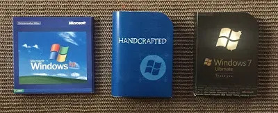
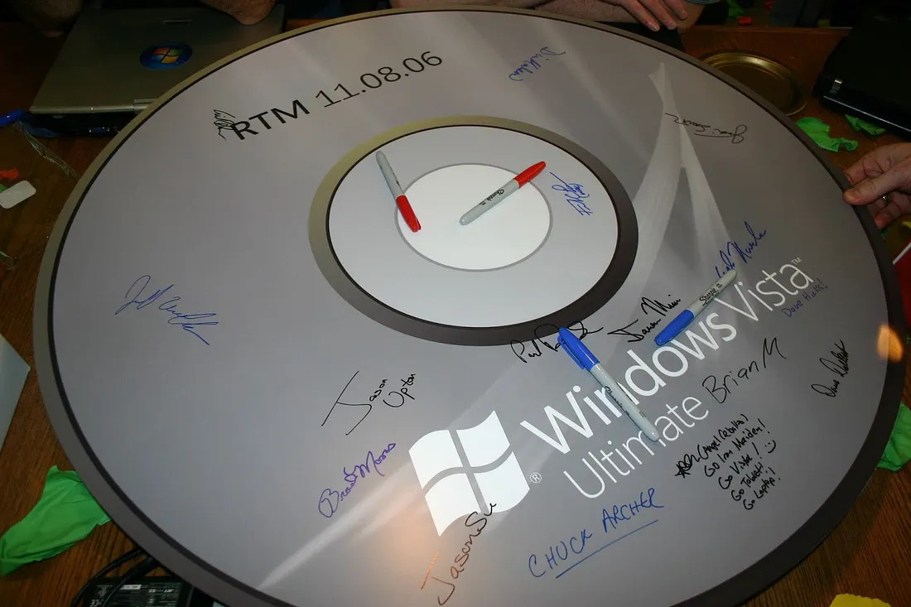
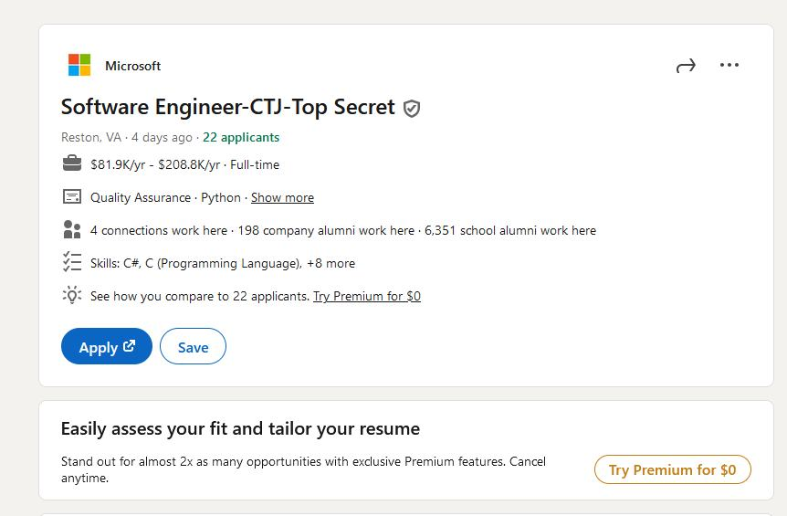


<!---->

  
<h2>Jonathan Romanov Moore FRSA </h2>

jonathanmoore@computer.org | jonathanmoore@sphinxlogic.onmicrosoft.com | https://sphinxlogic.visualstudio.com | Reston, Va, US 

* [Microsoft Windows 11 Full Disclousure](./credits.pdf)

* [Jonathan R Moore's Clio Award Confirmation Letter](./Clios/ClioAwardsAwardConfirmationLetterJonathanMoore.pdf)

* [Microsoft Employee Login](https://docs.microsoft.com/en-us/dynamics/s-e/howto)

* [Build Lab for Microsoft Employees and Partners](https://betawiki.net/wiki/Build_lab)

* [Charles Babbage Throws a Party](https://medium.com/@michaelswaine/charles-babbage-throws-a-party-e6abcef8fef1)

* [Moore No. 1 Family pedigree](https://www.libraryireland.com/Pedigrees1/Moore1Ir.php)

* [Inside The House Of Romanov: The $300 Billion Dynasty](https://www.therichest.com/rich-powerful/inside-the-house-of-romanov-the-300-billion-dynasty/)

* [Jonathan Romanov Moore's Personality](https://www.youtube.com/watch?app=desktop&v=pQyLjLqFNWY)

* [Jonathan's Macromedia Stock Merger](./Market/Macromedia/a2161099zf1_424b3.pdf)

* [Debugging Program Verification Proof Scripts ](https://arxiv.org/html/1804.04402v1)

Send $5 a component to the

Source Code Compliance Team

One Microsoft Way
 

Redmond, Wa 98052

My family never voted for President Nixon, my family comes from a high tax bracket. We own our home I lived on my own for 17 years. my great grandfather worked on the transcontinental railroad, my father is retired from the nations largest building materials company I'm a Moore, Hathaway, McCulley, Chapman, Bright and Little. My market portfolio has and will have of Microsoft, Apple, Amazon, Xerox, Intel, Tops, Unisys, and now a $30K nation wide mutual fund. For now. I'm not investing in social until there can be a social trading platform that is positive sum. I am paying for my GitHub, Apple Music and Website.

<h2>Anne Hathaway as retold By her cousin Jonathan David Allen Moore Now Legally Jonathan Romanov Moore by DNA Testing</h2>

I tested as Anne Hathaway the Actress DNA match in 2018 from National Genographic 2.0. My mother was on the board of the YWCA who named my blanket gigi after a Audrey Hepburn film in 1983. I worked for Macromedia and my first investment was at Moors and Cabot in 1999 for Disney and Macromedia, I was valedictorian of my prepatory college class in 2000 as she played a valaditorian in the TV Series 'Get Real' and the movie the Princess Diaries where she became a princess ands I recently discovered I was related to eh empirical House of Romanov from Russia.

In the movie 'Valenitines Day' were I relate to a San Fransico Executive and cheating on my high school sweetheart Katie. Macromedia the company I worked for won 4 Gold <b>Clio Awards</b> and as a INTJ-T in 2006 after finding out I was related to Jane Austin the author and the movie 'Becoming Jane' there are two references to me in the movie the retarded scene after I made fun of a retarad man at VHCC in 2006 in bolwing class and the boxing cousin scene. Another one was in Bride Wars were my roommates were getting married and and the uncanny likeness to them in the movie I grew up on Murphy Brown. Another one was Brokeback Mountain were in 2005 where I told my father about my homosexual experience in elementry school with Scott Shepard. Shepard is in the Bokeback Credits. Another one was Sex and Other Drugs were I won a <b>Microsoft SQL Server Sales Award</b> in 2007.
 

Another one was the movie 'Havoc' was her handicam as I sold a Sony handicamp to a friend in 1996. Another one was my Uncles Glenn's Flower Shop when I was my car to get fixed with Kara Kiser and her Valentines Day movie I stutter or used to and the Pete Townshend GS Scooter reference. She is very good at method acting with family. Another one was in Passengers the Movie with me always flirting with hospital staff. In the TV Series Modern Love Season 1 Episode 3 she mocked me always going to the grocery store and a letter from Brack Obama. Another one was in the movie the Idea of You. Where I chaperoned Tasha Sokolow and Frances Masterson at Lollapalooza 1996 and met the band Soundgarden.

Another one was the igunana scene and the mental ward scenes in the movie the Hustle my ex girlfiend had a igunana in college in 2000 and I went to SWVAMHI for rehab for stuttering which may just be a schism for a 1984 Orwell society <a href="https://www.independent.co.uk/news/world/sony-senses-a-market-in-esp-1577154.html">Sony ESP</a>, COCOMO II, 2006 Microsoft Tender Offer which was extended for 75 years, and a million dollar IRS return of intangables. Another one is in the Movie Armagedon Time Uncle Ray or Gene and Aunt Ruthie McCulley for which that doesn't have a marker on there grave in Glennwood Cemetary.

<h2>Determining the Value of a Perptual Licence</h2>

Craig Moore, VP, Principal Analyst

May 3 2012

Product marketers and managers are often asked to compare the price of a perpetually licensed product vs. a software-as-a-service (SaaS) based (consumption-based) license. To make the comparison, it’s essential that marketers know how to determine the value of each licensing model and understand their idiosyncrasies. This post demonstrates how to determine the value of a perpetually licensed product.

Product marketers and managers are often asked to compare the price of a perpetually licensed product vs. a software-as-a-service (SaaS) based (consumption-based) license. To make the comparison, it’s essential that marketers know how to determine the value of each licensing model and understand their idiosyncrasies. This post demonstrates how to determine the value of a perpetually licensed product.

A perpetual license gives the holder the right to use the software forever. Enterprise software is usually purchased along with maintenance, which provides updates to the software for a period of time. When analyzing a perpetual model, I recommend estimating the lifetime of the product’s use as the depreciation window, say three years. The cash flow of a three-year perpetual license of $5,000 plus 20 percent/year maintenance is as follows: Year 1, $5,000 plus $1,000; Year 2, $1,000; and Year 3, $1,000, for a total of $8,000. (Maintenance is paid at the beginning of each year.)

The present value calculation considers the cost of capital and the sum of discounted future cash flows in today’s dollars to produce an indicator of the license’s total value over time. Even when interest rates are low, you still have the opportunity cost of not using the funds for a different project, so you need to set a discount rate. Your finance department can help you determine the discount rate for your organization. Let’s use 10 percent for this example. Applying Microsoft Excel’s present value formula, the perpetually licensed product with discounted cash flows for the maintenance payments would have a present value of $7,735.

In my next post, I’ll look at how to calculate the value of a term license.

