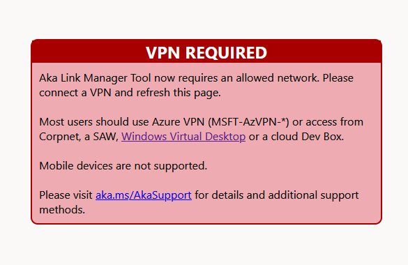
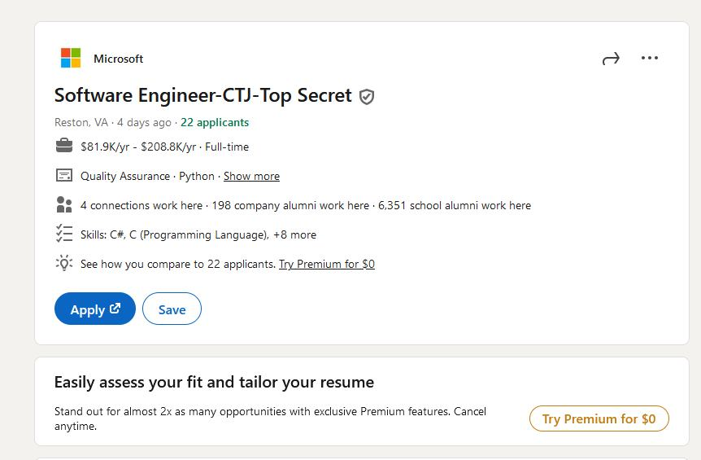



<!---->
  
<h2>Jonathan Romanov Moore FRSA </h2>

jonathanmoore@computer.org | jonathanmoore@sphinxlogic.onmicrosoft.com | https://sphinxlogic.visualstudio.com | Bristol, Va, USA 

My Role Designation at Microsoft is Partner Employee

* [The Sphinx Logic Website A Microsoft Tenured Startup](http://www.sphinxlogic.net)

* [Industry Internal Build Instructions](https://sphinxlogic.github.io/)

* [SAW Device](https://learn.microsoft.com/el-gr/security/zero-trust/sfi/saw-devices)

* [Jonathan R Moore's Clio Award Confirmation Letter](./JonathansRMooresPowerCard/ClioAwards/ClioAwardsAwardConfirmationLetterJonathanMoore.pdf)

* [Microsoft Employee Login](https://docs.microsoft.com/en-us/dynamics/s-e/howto)

* [Build Lab for Microsoft Employees and Partners](https://betawiki.net/wiki/Build_lab)

* [Charles Babbage Throws a Party](https://medium.com/@michaelswaine/charles-babbage-throws-a-party-e6abcef8fef1)

* [Moore No. 1 Family pedigree](https://www.libraryireland.com/Pedigrees1/Moore1Ir.php)

* [Inside The House Of Romanov: The $300 Billion Dynasty](https://www.therichest.com/rich-powerful/inside-the-house-of-romanov-the-300-billion-dynasty/)

* [Jonathan Romanov Moore's Personality](https://www.youtube.com/watch?app=desktop&v=pQyLjLqFNWY)

* [Jonathan's Macromedia Stock Merger](./Market/Macromedia/a2161099zf1_424b3.pdf)

* [Debugging Program Verification Proof Scripts ](https://arxiv.org/html/1804.04402v1)

* [Freud’s Contributions on Stuttering: Their Relation to Some Current Insights](https://psychiatryonline.org/doi/abs/10.1176/appi.psychotherapy.1960.14.1.210)

* [Microsoft Windows/Office Offical Device Partner](https://ntriver.org/)

* [What happens to our bodies after we die](https://www.bbc.com/future/article/20150508-what-happens-after-we-die)

* [UK–California climate and energy agreement ](https://www.gov.uk/government/publications/uk-california-climate-and-energy-agreement)

* [Towards a Topology for Legacy System Migration](https://dl.acm.org/doi/abs/10.1145/3387940.3391476)

* [Univesity of Kent Computer Mirror Service](https://www.mirrorservice.org/)

* [Windows 2000 update archive [Updated July 2026]](https://archive.org/details/win50-upd) :heart: NY

* [David Cutler — 2016 CHM Fellow](https://www.youtube.com/watch?v=J2GV_bCfnCw)

* [Jonathan R Moore's Microsoft Gold Partner](https://microsoft-os.github.io/)

* [Every Windows XP “Windows Update” in one download (+2019 patches)](https://nuangel.net/2015/04/every-windows-xp-windows-update-in-one-download/)

* [Every Windows Update for Windows 8, 8.1, Server 2012 R2 x86 / x64](https://nuangel.net/2026/06/every-windows-update-for-windows-8-8-1-server-2012-r2-x86-x64/)

* [Mac OS Rhapsody DR1, DR2 Intel (x86) & PPC](https://macintoshgarden.org/apps/rhapsody-dr1-dr2-intel-x86-ppc)

* [Area 51 Operating System Proposals](https://area51.stackexchange.com/)

* [TransferSize](https://www.transfersize.com/en)

* [Monopolies In The UK](https://www.studysmarter.co.uk/explanations/microeconomics/microeconomics-examples/monopolies-in-the-uk/)
  

Send $5 a component to the

Source Code Compliance Team

One Microsoft Way
 

Redmond, Wa 98052

<h2>Links</h2>

<a href="https://archive.org/details/windows_9">Microsoft Windows 9</a>

<a href="https://archive.org/details/sua-bundlecomplete60">Interop Systems</a>

<a href="https://archive.org/details/TheLegendOfZeldaEncyclopedia">The Legend Of Zelda Encyclopedia</a>

<a href="https://archive.org/details/windows-vista-security-updates-after-april-2017-eol">Windows Vista Security Updates After April 2017</a>

<a href="https://archive.org/details/SMWDisC">Super Mario World source code</a>

<a href="https://archive.org/details/open-step-entcd">OpenStep Enterprise 4.1, for Windows NT, HP-UX, and Solaris</a>

<a href="https://archive.org/details/aero-5048">Windows Longhorn Aero/DCE files</a>

<a href="https://archive.org/details/windows-xp-kernel-update">Microsoft Windows XP Kernel Updates</a>

<a href="https://archive.org/details/xpku-oca-5048dwm">Microsoft Windows XP Kernel Updates</a>

<a href="https://archive.org/details/Win8.1ProBuild9364x86">Microsoft Windows Build 9364 Confiendtial</a>

<a href="https://archive.org/details/7-Beta-XP-Srv2k3-en-US">Microsoft Windows XP to 7</a>

<a href="https://archive.org/details/win7_ultimate_x86_64">Microsoft Windows 7 Ultimate Signuature Series</a>

<a href="https://archive.org/details/win2ksource">Microsoft Windows 2000 Source Code</a>

<a href="https://psycnet.apa.org/record/2020-93235-006">Functional MRI findings in schizophrenia.</a>

<a href="https://www.forrester.com/blogs/determining-the-value-of-a-perpetual-license/">Determining the Value of a Perpetual License</a>

<a href="https://en.wikipedia.org/wiki/Moore_v._Regents_of_the_University_of_California">Moore v. Regents of the University of California</a>

<a href="https://archive.org/details/walnutcreekcdrom">Walnut Creek Collection</a>

<a href="https://ftp.zx.net.nz/pub/mirror/ftp.hp.com/">HP Freeware</a>

<a href="https://ftp.zx.net.nz/pub/mirror/sgi-freeware/">SGI IRIX Freeware</a>

<a href="https://www.microsoft.com/en-us/securityengineering/gsp?msockid=312bc345a4a06dbc26e6d530a50e6c4c">Government Security Program</a>

<a href="https://thirdpartysource.microsoft.com/">Third Party Disclosures</a>

<a href="https://dl.acm.org/doi/10.1145/2445196.2445344">Learning computer science in the "comfort zone of proximal development"</a>

<a href="https://www.forbes.com/sites/dbloom/2021/09/27/hollywood-edges-closer-to-strike-with-cinematographers-vote/">Hollywood Edges Closer To Strike With Cinematographers Vote</a>

<a href="https://channeldrive.in/cloud-computing/perficient-enables-azure-cloud-solutions-for-builders-firstsource/">Perficient Enables Azure Cloud Solutions for Builders FirstSource</a>

<a href="https://www.techpowerup.com/183152/digital-storm-ends-the-pre-built-vs-diy-debate-with-vanquish-line-of-gaming-pcs">Digital Storm Ends the Pre-Built vs. DIY Debate with VANQUISH Line of Gaming PCs</a>

<a href="https://docs.freebsd.org/en/books/handbook/cutting-edge/#building-on-non-freebsd-hosts">Building on Non FreeBSD</a>

<a href="https://blogs.microsoft.com/datalaw/initiative/legal-cases/microsofts-search-warrant-case/">Legal cases: Microsoft’s Search Warrant Case</a>

The Windows Repository is here <a href="http://microsoft.visualstudio.com">http://microsoft.visualstudio.com</a> You need a Personal Access Token

<a href="https://learn.microsoft.com/en-us/azure/devops/organizations/accounts/use-personal-access-tokens-to-authenticate?view=azure-devops&tabs=Windows">Personal Access Token</a>

<a href="https://learn.microsoft.com/en-us/entra/identity-platform/quickstart-create-new-tenant">Set up a new Microsoft Entra tenant</a>

<a href="https://github.com/windowsdevops">Windows DevOps</a>

<a href="https://github.com/icsharpcode/ilspy">ILSpy; Some Transparency</a>

<a href="https://www.newscientist.com/article/mg21829140-200-psychiatry-needs-its-higgs-boson-moment/">Psychiatry needs its higgs boson moment</a>

<a href="https://www.sciencedirect.com/science/article/pii/S0370269315001768">Stabilizing the Higgs potential with a Z′</a>

<h2>Operating Systems and Games</h2>
<ul>
  <li><a href="https://archive.org/details/win-95-osr-2">Microsoft Windows 95</a>
</li>
  <li><a href="https://www.riscosopen.org/content/">RISC OS Open Limited the Nintendo 64 & Cube Operating System</a>
</li>
  <li><a href="https://ultra64.ca/resources/software/">Nintendo 64 SDK's</a>
</li>
  <li><a href="https://github.com/windowsdevops/Microsoft-Windows-NT-4.0-Source-Kit">Windows NT 4.0 Source KIt</a>
</li>
  <li><a href="https://github.com/windowsdevops/Microsoft-Windows-Server-2003-Source-Kit">Windows Server 2003 Source Kit</a>
</li>
  <li><a href="https://archive.org/download/GamecubeCollectionByGhostware">Nintendo Game Cube Games</a>
</li>
  <li><a href="https://www.gc-forever.com/wiki/index.php?title=Main_Page">Game Cube Forever Wiki</a>
</li>
  <li><a href="https://games.softpedia.com/get/Tools/Gamecube-ISO-Tool.shtml">Game Cube ISO Tool</a>
</li>
  <li><a href="https://github.com/windowsdevops/Microsoft-Windows-Vista-Buffer-Lab03_n">Microsoft-Windows-Vista-Buffer-Lab03_n</a></li>
</ul>

<ul>
<li><a target="_self" href="VMS_Language_and_Tools_Handbook_1985.pdf">VMS Language and Tools Handbook 1985</a></li>
<li><a target="_self" href="https://wiki.vmssoftware.com/Main_Page">VMS Software Wiki</a></li>
<li><a target="_self" href="https://www.sciencedirect.com/science/article/abs/pii/S0304405X16300472">Time is money: Rational life cycle inertia and the delegation of investment management</a>
</ul>

<a href="https://www.libraryireland.com/Pedigrees1/Moore1Ir.php">Moore No. 1 Family pedigree</a>

<a href="https://www.youtube.com/watch?app=desktop&v=pQyLjLqFNWY">Jonathan David Allen (Windsor) Moore's Personality</a>

### Articles

* [Articles](https://microsoft-os.github.io/docs/building/articles.html)
* [Awesome Repositories](https://github.com/pawelborkar/awesome-repos)

### Microsoft in Government

* [Project Maven](https://en.wikipedia.org/wiki/Project_Maven)

### Software
* [Computer History Source Code](https://computerhistory.org/playlists/source-code/)
* [Spin Operating System](http://www-spin.cs.washington.edu/)
* [UNIX Heritage Society](https://www.tuhs.org/)
* [UNIX Migration Strategy to Windows](https://www.cygwin.com/)
* [VAX VMS Software](https://www.bitsavers.org/pdf/dec/)
* [Wallnut Creek Collection](https://archive.org/details/walnutcreekcdrom)
* [Microsoft OpenJDK](https://www.microsoft.com/openjdk)
* [Maven Repository](https://repo.maven.apache.org/maven2/)
* [OpenVMS Archive](https://www.digiater.nl/)
* [SCO](http://www.sco.com/skunkware/)
* [Keybase](https://keybase.io/)
* [PTC MKSToolkit for DOS](https://winworldpc.com/product/mks-toolkit/41)
* [Windows RTM and Code Name Betas](https://archive.org/details/full-windows-archive)
* [Apple OSS Distributions](https://github.com/apple-oss-distributions)
* [Apple Internals](https://mroi.github.io/apple-internals/)
* [MacOS Forge](https://www.macosforge.org/)
* [Macports compile maintainers to win32, link in Portfile](https://github.com/macports/)
* [fsck.technology](https://fsck.technology/)
* [GNUStep](http://www.gnustep.org/)
* [Microsoft Acrchive](https://github.com/microsoftarchive)
* [Oracle Virtual Box](https://www.virtualbox.org/)
* [BeOS/Haiku](https://www.haiku-os.org/)
* [Adobe CS2](https://archive.org/details/Adobe-CS2)
* [Microsoft Expression Studio for XAML Export](https://archive.org/details/microsoft-expression-studio)
* [IBM SIMH PDF](https://github.com/jonathanromanvmoore/simh)
* [CMU's AI Repository](https://www.cs.cmu.edu/Groups/AI/0.html)

### Xeinx
* [Microsoft Xeinx](https://archive.org/details/TNM_Xenix_operating_system_-_SCO_20180304_0122/mode/1up)

### MSDOS
* [Microsoft Lisp for DOS](http://www.edm2.com/index.php/Microsoft_LISP) 
* [Microsoft Pascal](https://winworldpc.com/product/microsoft-pascal/40)
* [Microsoft Fortran for DOS](https://winworldpc.com/product/microsoft-fortran/5x)
* [MSDOS 3.0](https://archive.org/details/msexe)

### Microsoft Windows Builds
* [Windows 1.0](https://archive.org/details/windows-1-0)
* [Windows 2.03](https://archive.org/details/microsoft-windows-2.03-3.5)
* [Windows 3.1](https://archive.org/details/windows-3.1-beta-1-build-34f)
* [Windows NT 3.5](https://archive.org/details/3.51.896-multifre-client-workstation-retail-en-us.-7z)
* [Windows NT 4.0](https://archive.org/details/nt-4-4.00.1166.1)
* [Windows 95](https://archive.org/details/microsoftwindowsdetroitbuild1009-1216collection16files)
* [Windows 98](https://archive.org/details/microsoftwindowsmemphisbuild1351-1998collection73files)
* [Windows Whistler](https://archive.org/details/windows-whistler-collection)
* [Windows Longhorn Build 4084](https://archive.org/details/windows-longhorn-build-4084)
* [Windows Longhorn/Vista](https://archive.org/details/thelonghornarchive)
* [Windows Longhorn Server](https://archive.org/details/os-microsoft-windows-longhorn-server)
* [Windows 7](https://archive.org/details/Microsoft-Windows-7-Build-Collection)
* [Windows 8](https://archive.org/details/os-microsoft-windows-8)
* [Windows 8.1](https://archive.org/details/os-microsoft-windows-8.1)
* [Windows 10](https://archive.org/details/10.0.10014.0.winmain-prs.-150205-1859-amd-64fre-client-professional-retail-en-us) 
* [Boot Windows Pre-Installation Environment](https://docs.microsoft.com/en-us/windows-hardware/manufacture/desktop/boot-to-winpe?view=windows-10)
* [Features On Demand](https://docs.microsoft.com/en-us/windows-hardware/manufacture/desktop/features-on-demand-v2--capabilities?view=windows-11)
* [Windows Volume Activation](https://docs.microsoft.com/en-us/previous-versions/windows/it-pro/windows-server-2012-r2-and-2012/dn502540(v=ws.11))
* [Unsupported WDK versions](https://learn.microsoft.com/en-us/windows-hardware/drivers/legacy-wdk-downloads)
* [Windows SDK Archive](https://learn.microsoft.com/en-us/windows/apps/windows-sdk/downloads-archive)
* [Windows ADK Downloads](https://learn.microsoft.com/en-us/windows-hardware/get-started/adk-install#other-adk-downloads)
* [Microsoft Shared Source Iniaitive](https://microsoft-os.github.io/docs/building/priemium/Shared%20Source%20Initiative%20_%20Debugging.htm)
* [Microsoft Code Plex Archive](https://archive.org/details/sylirana_ms_codeplex_zips)

### Sysinternals Suite
* [Sysinternals Suite](https://docs.microsoft.com/en-us/sysinternals/downloads/sysinternals-suite)
* [Windows Internals](https://docs.microsoft.com/en-us/sysinternals/resources/windows-internals)
* [Novels](https://trojanhorsethebook.com/wordpress/books/)

### Microsoft Reference Source
* [.NET Reference Source](https://referencesource.microsoft.com)

### Microsoft Enterprise Third Party Disclosures 
* [Microsoft Third Party Disclosures](https://thirdpartysource.microsoft.com/)
* [Visual Studio 2017 Third Party Disclosures](https://github.com/jonathanchapmanmoore/VisualStudioDisclosures)
* [Visual Studio Image Library](https://www.microsoft.com/en-us/download/details.aspx?id=35825)
* [IcoFX](https://icofx.ro/)

### Shared Source Common Language Infustructure
* [SSCLI](https://github.com/sphinxlogic/sscli) 
* [Common Type System](https://docs.microsoft.com/en-us/dotnet/standard/base-types/common-type-system)

### Common Compiler Infustructure
* [Common Compiler Infustructure](https://github.com/jonathanchapmanmoore/cci)

### Microsoft Open Source Teams
* [PowerShell](https://github.com/PowerShell/PowerShell)

### Microsoft Windows Kernel Source from MSDNAA
* [Windows XP Kernel Source, Project OZ, and CRK](https://github.com/sphinxlogic/WindowsResearchKernel)

### Microsoft SDKs
* [DirectX](https://archive.org/details/directxsdks)
* [Windows API Code Pack 1.1](https://www.nuget.org/packages/Microsoft-WindowsAPICodePack-Shell/)
* [Locale Builder 2.0](https://www.microsoft.com/en-us/download/details.aspx?id=41158)

### Microsoft Research
* [Singularity RDK 2.0](https://github.com/sphinxlogic/Singularity-RDK-2.0)
* [CHESS](https://github.com/jonathanchapmanmoore/Chess)
* [M#](http://licensing.msharp.co.uk/Login.aspx?ReturnUrl=%2fAdmin.aspx)
* [Microsoft Detours](https://github.com/microsoft/Detours)
* [Whitewater Foundry Ltd](https://github.com/WhitewaterFoundry)
* [BIND 9](https://www.isc.org/bind/)
* [OpenPegusus](https://collaboration.opengroup.org/pegasus/)

### macOS Build Collection
* [macOS Collection](https://archive.org/details/macos-collection)
* [iokit University of Utah](https://github.com/OSPreservProject/oskit)

### Taligent
* [Taligent](https://en.wikipedia.org/wiki/Taligent)

### Macromedia 

* [Mediamacros Director Xtras](http://mediamacros.com/)

### University of Cambridge
* [Nemesis](https://www.cl.cam.ac.uk/research/srg/netos/projects/archive/nemesis/)

### Operating System Perseve Project
* [OSPerserve](https://github.com/OSPreservProject)

### Personal 
* [Jonathan Chapman Moore FRSA Website](https://www.jonathanchapmanmoore.org/)
* [Microsoft Employee Login](https://docs.microsoft.com/en-us/dynamics/s-e/howto)
* [The Federal Tax Identification Number for Microsoft](https://support.microsoft.com/en-us/topic/the-federal-tax-identification-number-for-microsoft-0c0e93fc-b692-8d0a-748c-86714f1d7cea)
* [Blog](https://jdm7dvcsmath.blogspot.com/)
* [Code Project Moderator](https://www.codeproject.com/script/Membership/View.aspx?mid=527156)
* [Deviant Art](https://www.deviantart.com/jdm7dv)
* [Microsoft Announces Preliminary Results of Tender Offer](https://news.microsoft.com/2006/08/18/microsoft-announces-preliminary-results-of-tender-offer/)
* [Volunteered for the Forsight Insitute in 2001](https://foresight.org/our-history/)

### Links
* [How to pull a Bill Gates and don't let your company drown in cash](https://www.forbes.com/sites/johngreathouse/2015/03/23/pull-a-bill-gates-dont-let-your-company-drown-in-cash/)
* [Assessing the stability of egocentric networks over time using the digital participant-aided sociogram tool Network Canvas](papers/assessing_the_stability_of_egocentric_networks_over_time_using_the_digital_participantaided_sociogram_tool_network_canvas.pdf)
* [Stanford Network Analysis Project](http://snap.stanford.edu/)
* [Microsoft researchers win ImageNet computer vision challenge](https://blogs.microsoft.com/ai/microsoft-researchers-win-imagenet-computer-vision-challenge/)
* [Deep Neural Networks for Indoor Localization Using WiFi Fingerprints](https://link.springer.com/chapter/10.1007/978-3-030-22885-9_21)
* [Experimenting with Spirituality: Analyzing The God Gene in a Nonmajors Laboratory Course](https://www.ncbi.nlm.nih.gov/pmc/articles/PMC2262126/)
* [The Supreme Court pared down a controversial anti-hacking law](https://www.theverge.com/2021/6/5/22491859/supreme-court-van-buren-cfaa-hacking-law-scope-narrowed)

My family never voted for President Nixon, my family is from a high tax bracket. We own our home I lived on my own for 17 years. my great grandfather worked on the transcontinental railroad, my father is retired from the nations largest building materials company I'm a Moore, Hathaway, McCulley, Chapman, Bright and Little. My market portfolio has and will have of Microsoft, Sony, Nintendo, Square Enix, Apple, Amazon, Xerox, Intel, Tops, Unisys, and now a $30K nation wide mutual fund. For now. I'm not investing in social until there can be a social trading platform that is positive sum. Sigmund Freud supported stuttering children and their identity and so do I. I might support the Freud Foundation next year. I am supporting the University of California State Fullerton and a tested INTJ-T and UVa Wise in the Founders Society. I was ACM Vice President of the UVa Wise Chapter.

I graduated High School With a 2.7 GPA Preparatory school in the USA with a 4.0 GPA and am a UVa Alumni with a 3.2 GPA and Virginia scholar award. and Microsoft Alumni, working on Apple or Adobe Alumni. I am paying for my GitHub, Apple Music and Website. I'm direct decadents of the House Romanov $300 billion dollar dynasty and the famed Charles Darwin. I'll vote again when the USA can be partisan and make sense and doctors learn about postmodernism. There can be a free society if its just fair and faithful. I might need to be put on Prozac I have a Microsoft Tender offer worth $20 million and extended for 75 years. Looking to invest 15% of illiquid assets of my tender offer or about $3 million. I have letter's from President's Obama and Trump and Microsoft's Bill Gates and Steve Ballmer.

Universities are not allowed to make celebrities the monarchy is the monarchy currently following entertainment law. Therefore I'm only continuing my RSA fellowship to receive diplomatic immunity. I'm suing RSA for common person practice since 2000 at Microsoft Legal.

Microsoft 700GB Windows 2000 DNA Suite With Source, Sun One Enterprise, Microsoft Softimage 3.0, <a href="https://interix.com/">Full Interix 2.2 Suite</a> and Rational Rose Software to be released when Anne Hathaway the actress gets a divorce from Adam Shulman by Sphinx Logic In Vogue Magazine and the USA regrets the breakup of Microsoft and TCAT had a write up in the NY Times restored to Wikipedia. Also working with the ACM on Complex Adaptive Systems.

I'm Is still trying to be and Adobe alumni with about 12 aquisions.My late uncle was Cutris Hathaway who lived in West Virginia, the same state featured in Anne Hathaway's Movie 'Dark Waters'

<!--<h2>Anne Hathaway as retold By her cousin Jonathan David Allen Moore Now Legally Jonathan Romanov Moore by DNA Testing</h2>

I tested as Anne Hathaway the Actress DNA match in 2018 from National Genographic 2.0. My mother was on the board of the YWCA who named my blanket gigi after a Audrey Hepburn film in 1983. I worked for Macromedia and my first investment was at Moors and Cabot in 1999 for Disney and Macromedia, I was valedictorian of my preparatory college class in 2000 as she played a valedictorian in the TV Series 'Get Real' and the movie the Princess Diaries where she became a princess and I recently discovered I was related to eh empirical House of Romanov from Russia.

In the movie 'Valenitines Day' were I relate to a San Fransisco Executive and cheating. Macromedia the company I worked for won 4 Gold <b>Clio Awards</b> and as a INTJ-T in 2006 after finding out I was related to Jane Austin the author and the movie 'Becoming Jane' there are two references to me in the movie the retarded scene after I made fun of a retarad man at VHCC in 2006 in bolwing class and the boxing cousin scene. Another one was in Bride Wars were my roommates were getting married and and the uncanny likeness to them in the movie I grew up on Murphy Brown. Another one was Brokeback Mountain were in 2005 where I told my father about my homosexual experience in elementary school with Scott Shepard. Shepard is in the Bokeback Credits. Another one was Sex and Other Drugs were I won a <b>Microsoft SQL Server Sales Award</b> in 2007.
 

Another one was the movie 'Havoc' was her handicam as I sold a Sony handicamp to a friend in 1996. Another one was my Uncles Glenn's Flower Shop when I was my car to get fixed with Kara Kiser and her Valentines Day movie I stutter or used to and the Pete Townshend GS Scooter reference. She is very good at method acting with family. Another one was in Passengers the Movie with me always flirting with hospital staff. In the TV Series Modern Love Season 1 Episode 3 she mocked me always going to the grocery store and a letter from Brack Obama. Another one was in the movie the Idea of You. Where I chaperoned Tasha Sokolow and Frances Masterson at Lollapalooza 1996 and met the band Soundgarden.

Another one was the igunana scene and the mental ward scenes in the movie the Hustle my ex girlfiend had a igunana in college in 2000 and I went to SWVAMHI for rehab for stuttering which may just be a schism for a 1984 Orwell society <a href="https://www.independent.co.uk/news/world/sony-senses-a-market-in-esp-1577154.html">Sony ESP</a>, COCOMO II, 2006 Microsoft Tender Offer which was extended for 75 years, and a million dollar IRS return of intangables. Another one is in the Movie Armagedon Time Uncle Ray or Gene and Aunt Ruthie McCulley for which that doesn't have a marker on there grave in Glennwood Cemetary.
-->

<h2>Determining the Value of a Perptual Licence</h2>

Craig Moore, VP, Principal Analyst

May 3 2012

Product marketers and managers are often asked to compare the price of a perpetually licensed product vs. a software-as-a-service (SaaS) based (consumption-based) license. To make the comparison, it’s essential that marketers know how to determine the value of each licensing model and understand their idiosyncrasies. This post demonstrates how to determine the value of a perpetually licensed product.

Product marketers and managers are often asked to compare the price of a perpetually licensed product vs. a software-as-a-service (SaaS) based (consumption-based) license. To make the comparison, it’s essential that marketers know how to determine the value of each licensing model and understand their idiosyncrasies. This post demonstrates how to determine the value of a perpetually licensed product.

A perpetual license gives the holder the right to use the software forever. Enterprise software is usually purchased along with maintenance, which provides updates to the software for a period of time. When analyzing a perpetual model, I recommend estimating the lifetime of the product’s use as the depreciation window, say three years. The cash flow of a three-year perpetual license of $5,000 plus 20 percent/year maintenance is as follows: Year 1, $5,000 plus $1,000; Year 2, $1,000; and Year 3, $1,000, for a total of $8,000. (Maintenance is paid at the beginning of each year.)

The present value calculation considers the cost of capital and the sum of discounted future cash flows in today’s dollars to produce an indicator of the license’s total value over time. Even when interest rates are low, you still have the opportunity cost of not using the funds for a different project, so you need to set a discount rate. Your finance department can help you determine the discount rate for your organization. Let’s use 10 percent for this example. Applying Microsoft Excel’s present value formula, the perpetually licensed product with discounted cash flows for the maintenance payments would have a present value of $7,735.

In my next post, I’ll look at how to calculate the value of a term license.

